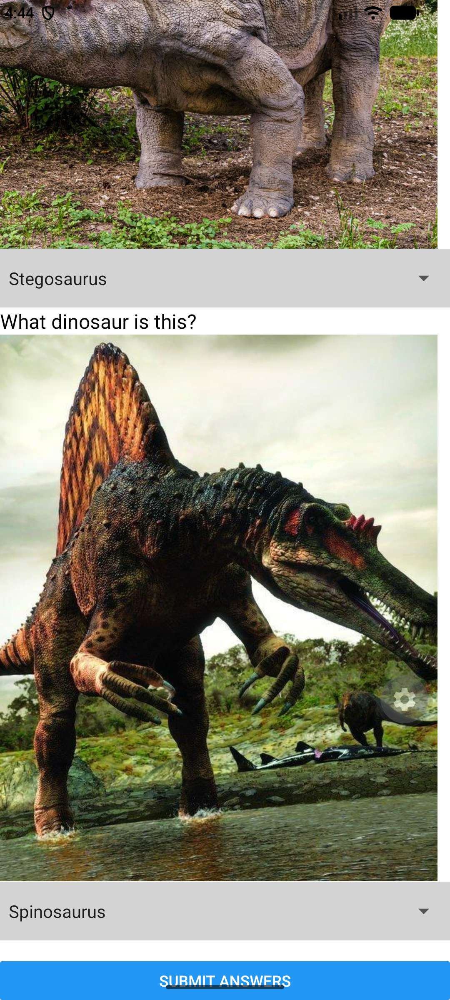
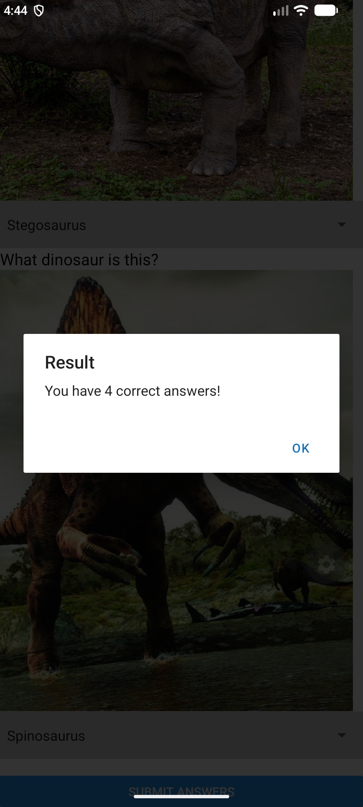

<!-- Create a file README.MD in L04Boats folder and paste following content in it -->
# App Name

A brief description of the mobile application and its purpose.  
(This app allows user to view and buy Boats.)

# ScreenShots of App
Top page screenshot:  

Bottom page screenshot:  
